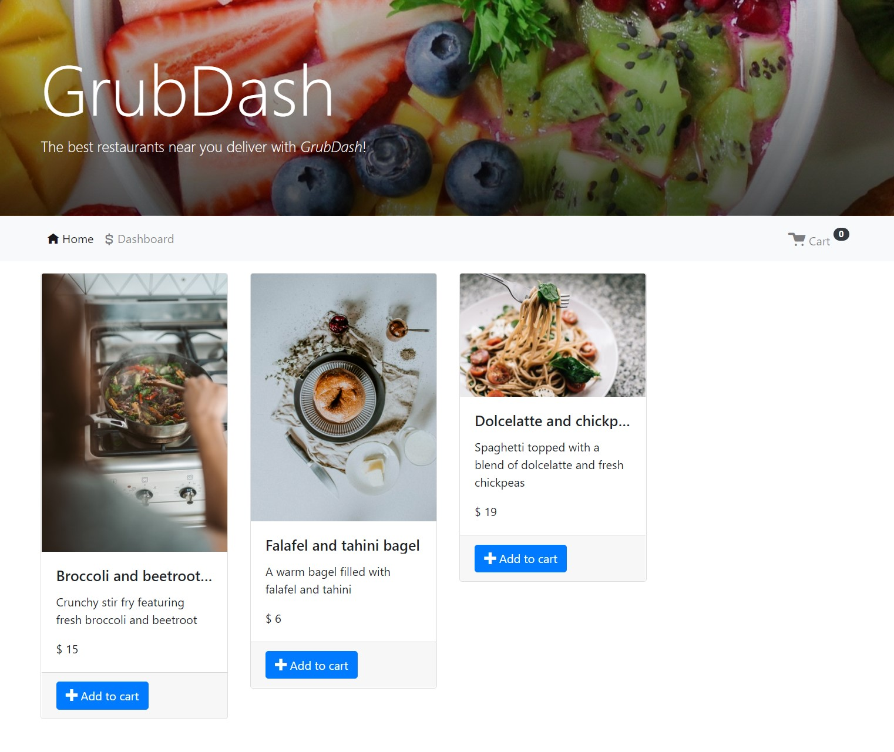

# GrubDash API

A Node.js and Express coursework API for a fictional food delivery service. It demonstrates routing, request validation, error handling, and automated API tests for managing dishes and orders.

## Live demo

[Open GrubDash](https://grubdash-portfolio-demo.vercel.app/demo/) — browse dishes, add items to the cart, and submit a fictional order. The dashboard supports sample dish and order updates. This replacement serves the frontend and API together; it does not use the retired Heroku backend.

Use fictional details only. The demo has shared, temporary sample data; it does not place real orders or take payments.

## Project context and contributions

This project began as a Thinkful assignment. The frontend and course scaffolding were provided; my work focused on backend endpoints, route handlers, and custom validation. A subsequent portfolio refresh adds regression tests, repairs validation and identity handling, and documents setup and limitations. This is an educational project, not commissioned client work.

## Run locally

Verified with Node.js 22.14.0 and npm 10.9.2. From the repository root:

```sh
npm ci --ignore-scripts
npm test
npm run build:demo
npm start
```

The server listens at http://localhost:5000 by default. Set the optional PORT environment variable to use another port. Open http://localhost:5000/demo/ for the restored frontend. No API keys or external services are required. Run npm run start:dev for development with automatic restarts.

## Try the API

Open http://localhost:5000/dishes to inspect seeded dishes. With the server running, this command creates a dish using Node's built-in fetch:

```sh
node -e "fetch('http://localhost:5000/dishes', {method:'POST', headers:{'Content-Type':'application/json'}, body:JSON.stringify({data:{name:'Vegetable soup',description:'A sample dish',price:500,image_url:'https://example.com/soup.jpg'}})}).then(async r => console.log(r.status, await r.json()))"
```

A successful creation returns HTTP 201 and the saved object inside a data property, including a generated ID. The example image URL is illustrative.

## Endpoints

| Method | Path | Behavior |
|---|---|---|
| GET | /dishes | List dishes |
| POST | /dishes | Create a dish |
| GET | /dishes/:dishId | Read a dish |
| PUT | /dishes/:dishId | Replace editable dish fields |
| GET | /orders | List orders |
| POST | /orders | Create an order |
| GET | /orders/:orderId | Read an order |
| PUT | /orders/:orderId | Replace editable order fields |
| DELETE | /orders/:orderId | Delete a pending order |

POST and PUT bodies use a JSON data object. PUT requires the complete editable record, rather than a partial patch. Dish fields are name, description, image_url, and a positive integer price. This demo uses integer price values without a currency-conversion feature.

Orders require deliverTo, mobileNumber, and a nonempty dishes array whose entries have positive integer quantities. Include status explicitly when creating an order intended for further workflow actions. Updates require one of pending, preparing, out-for-delivery, or delivered. Existing delivered orders cannot be modified; only pending orders can be deleted. Dish entries are snapshots, not live references to the dishes collection.

Existing record IDs remain stable on update. A nonempty submitted ID must match the route. Unsupported methods return 405; unknown records return 404; validation failures return 400 with an error message. Successful deletion returns 204 without a body.

## Tests and design

Run npm test for the original route suites and added regression tests. The regression suite covers rejected quantities, invalid statuses, delivered-order behavior, stable dish IDs, fractional prices, malformed data, and stopping middleware after rejection.

Controllers separate validation middleware from route handlers. Data arrays keep the exercise easy to run without a database; this is also its main persistence limitation. Tests exercise HTTP behavior through the application and confirm that rejected requests leave stored data unchanged.

## Limitations

- All changes live in process memory. They can reset on restarts, deployments, or when the hosting platform serves another function instance. There is no database or durable order history.
- No authentication, authorization, rate limiting, payment handling, or durable audit history is implemented. The public demo is an unauthenticated shared sandbox: use fictional data only.
- Validation is intentionally limited; this is not a complete ordering system or a production service.
- The historical frontend demo is broken: its deployed JavaScript targets https://grubdash-back-end.herokuapp.com, whose /dishes endpoint returned HTTP 404 with a Heroku "No such app" page on October 21, 2026. The frontend HTML still loads, but this does not constitute a working demo. The replacement demo linked above has been verified separately.

## Frontend restoration and deployment

The supplied React frontend was restored from the old deployment's public source map, with attribution in frontend/README.md. API requests now use the same origin. The refresh also fixes order-edit navigation, saving the delivered status, and the mobile-number field label/default. Bootstrap and supporting UI assets are bundled locally. The existing frontend versions are retained for compatibility; this is not a UI framework modernization.

Vercel detects src/app.js as the Express entrypoint, builds the UI with npm run build:demo, and serves public/demo assets. The Vercel configuration is included. Automatic Git deployments are not connected yet; the verified deployment was made using the Vercel CLI.

## Historical frontend screenshot

The assignment's supplied frontend provides context for the API. This screenshot does not establish a currently working deployment or original UI design.


